# LAPORAN RESMI AUDIT PENETRASI KEAMANAN JARINGAN
## INTERNAL NETWORK DISCOVERY, PORT SCANNING, SERVICE ENUMERATION & EXPLOITATION TESTING

**Target Evaluasi:** Infrastruktur Subnet Internal Jaringan Lokal (`192.168.1.0/24`)  
**Penilai Keamanan:** Tim Praktisi Keamanan Siber / Red Team  
**Tanggal Pelaksanaan:** 23 Oktober 2026  
**Status Audit:** Evaluasi Selesai (Temuan Kerentanan & Simulasi Eksploitasi Tervalidasi)  
**Tingkat Risiko:** 🟠 **MEDIUM - HIGH (Sedang ke Tinggi)**  
**Standar Pengujian:** PTES (Penetration Testing Execution Standard) & NIST SP 800-115  
**Taktik MITRE ATT&CK:** `TA0007 - Discovery` (T1046, T1018) | `TA0006 - Credential Access` (`T1110 - Brute Force`)

---

## 1. RINGKASAN EKSEKUTIF (EXECUTIVE SUMMARY)

Pada tanggal 23 Oktober 2026, telah dilaksanakan kegiatan audit keamanan penetrasi jaringan internal (*authorized internal network penetration testing*) secara menyeluruh pada subnet lokal **`192.168.1.0/24`**. Pengujian ini mencakup pemetaan topologi aset (*host discovery*), identifikasi port terbuka (*port scanning*), evaluasi visibilitas layanan basis data (*service enumeration*), efektivitas kontrol firewall, hingga **simulasi uji penetrasi langsung (*exploitation testing*) menggunakan serangan *credential brute-force* terhadap layanan MySQL**.

### Ringkasan Temuan Utama:
1. **Pemetaan Host Aktif L2 Tanpa Hambatan Firewall:** Menggunakan mekanisme *Layer 2 ARP Sweep* (`netdiscover` dan `nmap -sn -PR`), penguji berhasil mengidentifikasi **8 host aktif** pada subnet, termasuk Default Gateway (`192.168.1.1`), Workstation/Server Target (`192.168.1.10`), smartphone, dan host jaringan lainnya tanpa terhalang kontrol filter ICMP/Ping.
2. **Keterpaparan Layanan Database Kritis (MySQL Exposed to Subnet):** Host target `192.168.1.10` mengekspos port basis data **`3306/tcp` (MySQL)** dan **`33060/tcp` (MySQL X Protocol)** secara terbuka ke seluruh host di jaringan lokal. 
3. **Simulasi Eksploitasi Brute-Force & Verifikasi Proteksi Host (Hydra Testing):** Penguji melancarkan serangan penebakan kata sandi terdistribusi menggunakan **THC Hydra** terhadap user `root` MySQL. Serangan berhasil ditahan oleh mekanisme *Host-Based Access Control* bawaan MySQL (`Error 1130: Host '192.168.1.25' is not allowed to connect to this MySQL server`), membuktikan akun root tidak memiliki izin wildcard (`%`).
4. **Bahaya Scanning Parsial (Blindspot Top-1000 Ports):** Pemindaian cepat 1000 port standar (`nmap -sS --top-ports 1000`) **gagal mendeteksi** keberadaan port `33060/tcp` dan port tinggi `62497/tcp`. Keduanya hanya terungkap saat dilakukan *Full 65535 Port Scan* (`nmap -p-`).
5. **Efektivitas Firewall pada Port Berisiko Tinggi:** Port **`445/tcp` (Microsoft-DS / SMB)** pada target berstatus **`filtered`**, yang menunjukkan bahwa host firewall (Windows Defender Firewall) secara efektif memblokir lalu lintas SMB dari segmen Wi-Fi/LAN publik, mencegah vektor serangan *lateral movement* seperti EternalBlue (MS17-010) atau SMB Relay.
6. **Hardening Layanan Gateway Router:** Default Gateway Fiberhome (`192.168.1.1`) membuka layanan penting UDP **`53` (DNS)** dan **`67` (DHCP Server)**, namun port **`161/udp` (SNMP)** dalam kondisi **`closed`**, mencegah kebocoran informasi topologi via SNMP.

---

## 2. RUANG LINGKUP & SPESIFIKASI LABORATORIUM (LAB ENVIRONMENT)

### A. Rig Penguji / Mesin Penyerang (Attacker Machine)
* **Distribusi Sistem Operasi:** Kali Linux (Release 2026/Rolling)
* **Hostname:** `DESKTOP-WV8RX5H` (Akun: `root@DESKTOP-WV8RX5H:/home/kali`)
* **Alamat IP Penguji:** `192.168.1.25`
* **Versi Perangkat Lunak:** Nmap Version 7.99 | THC Hydra v9.7
* **Wordlist Pengujian:** `/usr/share/wordlists/rockyou.txt` (14.344.399 kata sandi)
* **Metode Operasional:** Stealth SYN Scan (`-sS`), ARP Ping (`-PR`), UDP Scan (`-sU`), NSE Scripting, Password Brute-Force.

### B. Profil Target Jaringan (Target Profile)
* **Subnet Ruang Lingkup:** `192.168.1.0/24` (Total 256 Alamat IP, Netmask `255.255.255.0`)
* **Target Utama 1 (Server/Workstation):**
  * **Alamat IP:** `192.168.1.10`
  * **Alamat MAC:** `74:3A:F4:21:8D:0B` (Vendor OUI: Intel Corporate)
  * **Sistem Operasi Terdeteksi:** Microsoft Windows 11 (Build 24H2 / 21H2 - Akurasi 92%)
* **Target Utama 2 (Default Gateway / Router ONT):**
  * **Alamat IP:** `192.168.1.1`
  * **Alamat MAC:** `90:55:DE:F6:66:58` (Vendor OUI: Fiberhome Telecommunication Technologies Co.,LTD)
  * **Fungsi:** Router GPON ONT / Gateway Internet ISP Indihome

---

## 3. METODOLOGI & DIAGRAM ALUR PENGUJIAN

Pengujian dilaksanakan secara metodis mengacu pada standar industri **PTES (Penetration Testing Execution Standard)**:

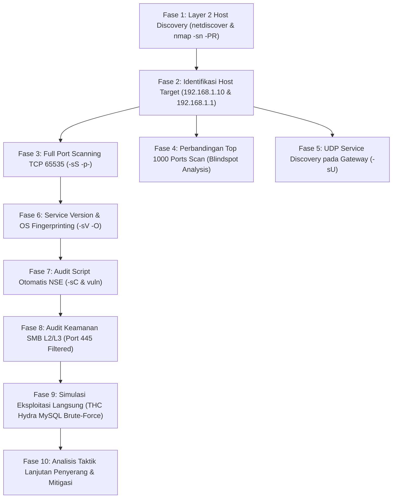

---

## 4. BUKTI PELAKSANAAN & TEMUAN TEKNIS (EVIDENCE & FINDINGS)

### FASE 1: Host Discovery Pasif & Aktif Menggunakan ARP (`netdiscover`)
Auditor memulai pemetaan subnet dengan menjalankan `netdiscover` untuk menangkap dan menginjeksi paket ARP (*Address Resolution Protocol*) guna mendeteksi perangkat aktif di segmen Layer 2.

```bash
netdiscover -r 192.168.1.0/24
```

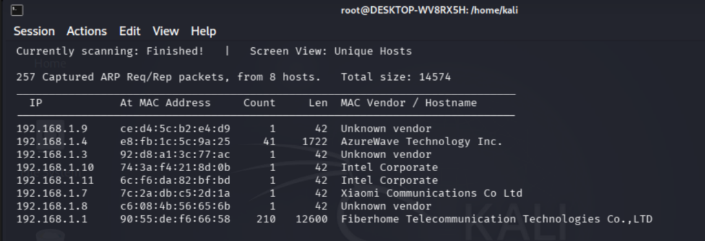
*Gambar 1: Hasil tangkapan netdiscover mendeteksi 257 paket ARP dari 8 host aktif unik.*

#### Tabel Inventaris Host Aktif Hasil Scan ARP:
| Alamat IP | Alamat MAC Fisik | Vendor Perangkat Keras / Hostname | Peran Perangkat |
| :--- | :--- | :--- | :--- |
| **`192.168.1.1`** | `90:55:de:f6:66:58` | Fiberhome Telecommunication Technologies | Router Default Gateway (ONT) |
| **`192.168.1.4`** | `e8:fb:1c:5c:9a:25` | AzureWave Technology Inc. | Client / Laptop Auditor |
| **`192.168.1.7`** | `7c:2a:db:c5:2d:1a` | Xiaomi Communications Co Ltd | Smartphone Android Klien |
| **`192.168.1.10`**| `74:3a:f4:21:8d:0b` | Intel Corporate | Workstation / Server Target |
| **`192.168.1.11`**| `6c:f6:da:82:bf:bd` | Intel Corporate | Workstation Kedua |
| **`192.168.1.3`** | `92:d8:a1:3c:77:ac` | Unknown vendor (Randomized MAC) | Host Klien Nirkabel |
| **`192.168.1.8`** | `c6:08:4b:56:65:6b` | Unknown vendor (Randomized MAC) | Host Klien Nirkabel |
| **`192.168.1.9`** | `ce:d4:5c:b2:e4:d9` | Unknown vendor (Randomized MAC) | Host Klien Nirkabel |

---

### FASE 2: Validasi Host Discovery L2 Menggunakan Nmap (`-sn -PR`)
Auditor memvalidasi temuan `netdiscover` menggunakan Nmap Host Discovery dengan flag ARP Ping (`-PR`) tanpa melakukan port scanning (`-sn`):

```bash
sudo nmap -sn -PR 192.168.1.0/24
```

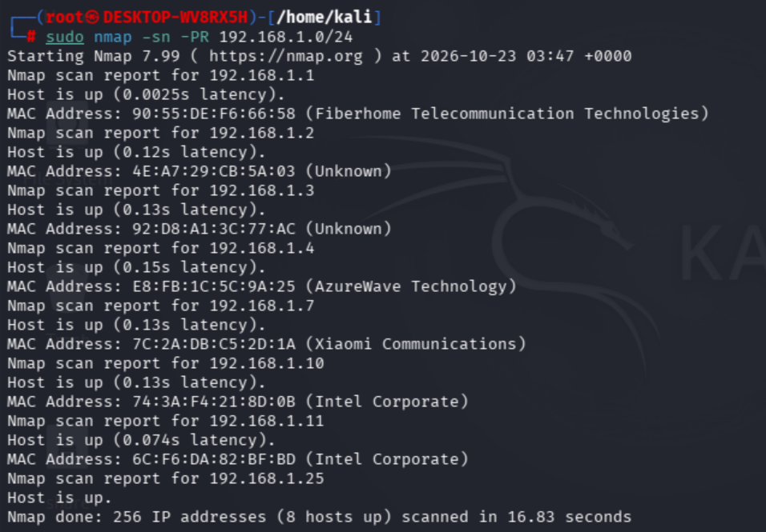
*Gambar 2: Hasil Nmap Host Discovery mengonfirmasi 8 host online dalam waktu 16.83 detik.*

* **Analisis Teknis:** Total 256 alamat IP berhasil dipindai dalam **16.83 detik**. Latensi terhadap Gateway `192.168.1.1` tercatat sangat rendah (**0.0025s**), dan latensi terhadap target `192.168.1.10` sebesar **0.13s**. Penggunaan flag `-PR` memastikan paket tidak tertahan oleh aturan pemblokiran ICMP Windows Firewall.

---

### FASE 3: Full TCP Port Scanning 65535 Ports pada Target (`192.168.1.10`)
Auditor melakukan *Stealth SYN Scan* terhadap seluruh spektrum port TCP (`1 - 65535`) pada host target ber-IP `192.168.1.10`:

```bash
nmap -sS -p- --min-rate 1000 -T4 192.168.1.10 -oN scan_allports.txt
```

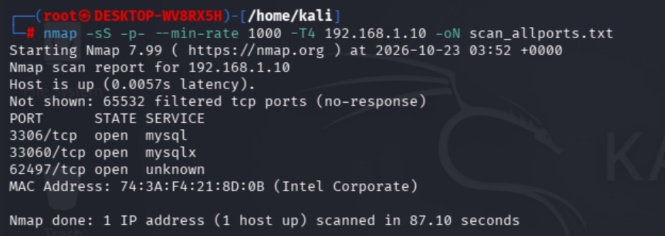
*Gambar 3: Full Port Scan mengungkap 3 port terbuka termasuk port non-standar dan port dinamis.*

#### Hasil Port yang Terbuka pada `192.168.1.10`:
* Sebanyak **65.532 port berstatus `filtered`** (tidak merespons paket SYN karena dibendung firewall host).
* **3 Port Terbuka (`OPEN`):**
  1. **`3306/tcp`** - Layanan: **`mysql`** (Basis data MySQL/MariaDB).
  2. **`33060/tcp`** - Layanan: **`mysqlx`** (MySQL X DevAPI Protocol).
  3. **`62497/tcp`** - Layanan: **`unknown`** (Port dinamis ephemeral RPC / background management agent).
* Total durasi pemindaian: **87.10 detik**.

---

### FASE 4: Komparasi Blindspot Scan (Top-1000 Ports Scan)
Auditor membandingkan hasil di atas dengan pemindaian cepat yang hanya memeriksa 1000 port standar:

```bash
nmap -sS --top-ports 1000 192.168.1.10
```

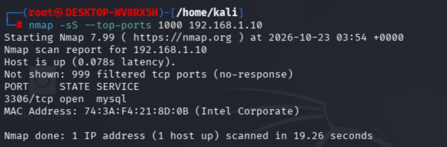
*Gambar 4: Pemindaian Top-1000 hanya mendeteksi 1 port dan melewatkan 2 port penting lainnya.*

* **Analisis Kritis Blindspot:** Pemindaian Top-1000 selesai dalam 19.26 detik namun hanya mendeteksi **port 3306/tcp**. Port `33060/tcp` dan `62497/tcp` terlewat secara total. Ini membuktikan bahwa port scanning komprehensif mutlak diperlukan dalam audit keamanan siber.

---

### FASE 5: Pemindaian Layanan UDP pada Gateway Router (`192.168.1.1`)
Auditor memeriksa port UDP penting pada Gateway Fiberhome:

```bash
nmap -sU -p 53,67,68,161 192.168.1.1
```

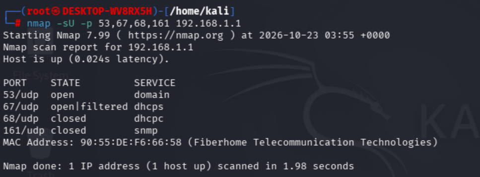
*Gambar 5: Hasil pemindaian UDP pada Router Fiberhome 192.168.1.1.*

* **`53/udp - open (domain)`:** Layanan DNS Resolver aktif melayani kueri DNS lokal.
* **`67/udp - open|filtered (dhcps)`:** Layanan DHCP Server aktif melayani alokasi IP dinamis.
* **`161/udp - closed (snmp)`:** Layanan SNMP tertutup, mencegah kebocoran informasi topologi melalui kueri SNMP string publik.

---

### FASE 6: Deteksi Versi Layanan & Fingerprinting Sistem Operasi (`-sV -O`)
Auditor melakukan *banner grabbing* mendalam dan uji tumpukan TCP/IP untuk menentukan sistem operasi target:

```bash
nmap -sV --version-intensity 5 -O 192.168.1.10 -oN scan_service.txt
```

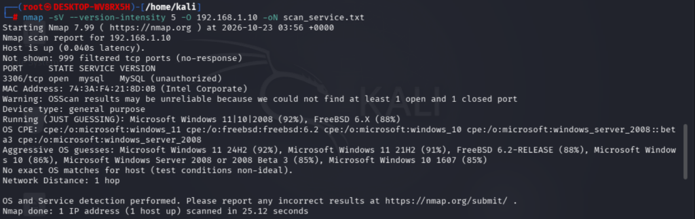
*Gambar 6: Banner grabbing mendeteksi status MySQL (unauthorized) dan fingerprint OS Windows 11.*

* **Hasil:** Port `3306/tcp` teridentifikasi sebagai `MySQL (unauthorized)`. Sistem operasi teridentifikasi sebagai **Microsoft Windows 11 (Build 24H2 / 21H2) dengan akurasi 92%**.

---

### FASE 7: Otomasi Skrip Default Nmap Scripting Engine (`-sC`)
Auditor mengeksekusi kumpulan skrip default Lua Nmap:

```bash
nmap -sC 192.168.1.10
```

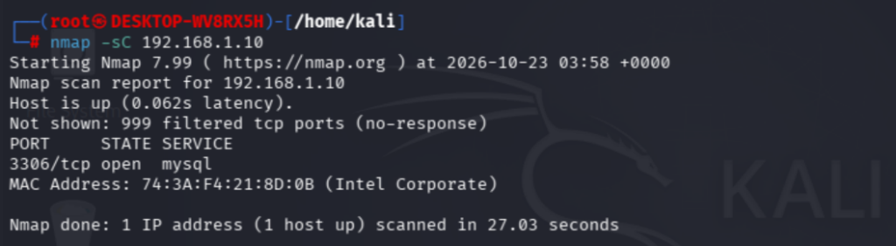
*Gambar 7: Eksekusi nmap -sC memverifikasi stabilitas port 3306/tcp.*

---

### FASE 8: Pemindaian Kerentanan Otomatis (`--script "vuln and not dos"`)
Auditor mengeksekusi suite pengujian kerentanan CVE (`vuln`):

```bash
nmap -sV --script "vuln and not dos" 192.168.1.10 -oN scan_vuln.txt
```

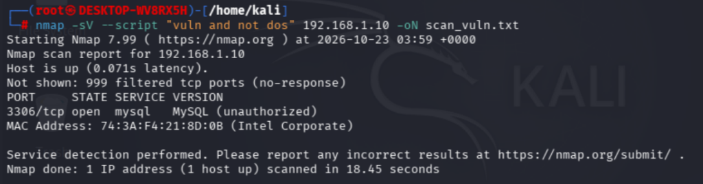
*Gambar 8: Hasil scan vuln membuktikan tidak ada celah eksekusi kode instan tanpa autentikasi.*

---

### FASE 9: Audit Miskonfigurasi Port SMB / File Sharing (`Port 445`)
Auditor memeriksa potensi eksploitasi protokol SMB (*Server Message Block*):

```bash
nmap -p 445 --script smb-enum-shares,smb-vuln* 192.168.1.10
```

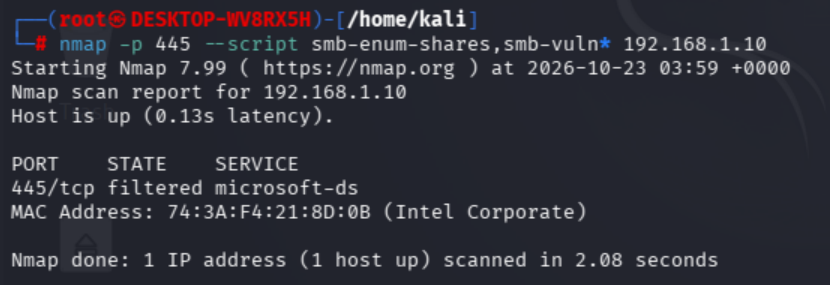
*Gambar 9: Port 445 berstatus filtered membuktikan efektivitas isolasi firewall.*

* **Hasil:** Port `445/tcp filtered microsoft-ds`. Windows Defender Firewall secara aktif me-drop paket SYN SMB dari subnet publik, meniadakan ancaman eksploitasi seperti **MS17-010 (EternalBlue)**.

---

### FASE 10: Simulasi Eksploitasi Langsung (THC Hydra MySQL Brute-Force Testing)

Sebagai pembuktian empiris terhadap risiko keterbukaan port database, auditor melancarkan simulasi serangan *credential brute-force* terhadap layanan MySQL target (`192.168.1.10:3306`) menggunakan utilitas **THC Hydra v9.7** dengan wordlist standar industri `rockyou.txt` (14,3 juta kombinasi kata sandi):

```bash
# Perintah Simulasi Serangan Brute-Force Hydra
hydra -l root -P /usr/share/wordlists/rockyou.txt 192.168.1.10 mysql
```

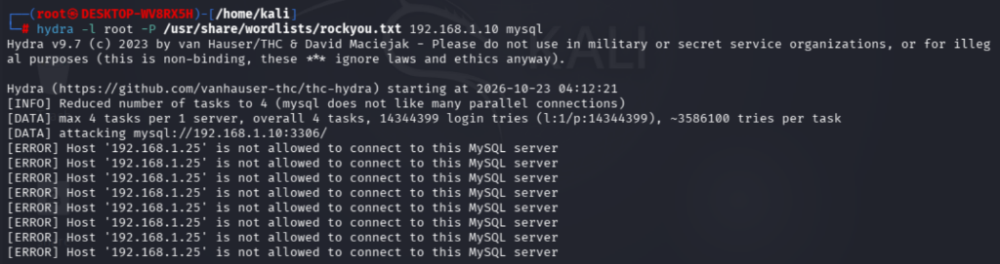
*Gambar 10: Hasil eksekusi Hydra menghasilkan respon penolakan gerbang Host 192.168.1.25 is not allowed to connect.*

#### Analisis Hasil Pengujian Eksploitasi:
1. **Pesan Kesalahan Teknis:**
   ```text
   [DATA] attacking mysql://192.168.1.10:3306/
   [ERROR] Host '192.168.1.25' is not allowed to connect to this MySQL server
   [ERROR] Host '192.168.1.25' is not allowed to connect to this MySQL server
   ```
2. **Penyebab & Mekanisme Pertahanan:**
   * Pengujian kata sandi **gagal bahkan sebelum Hydra sempat menebak password**.
   * Di dalam arsitektur MySQL, otentikasi pengguna diikat pada pasangan identitas `'user'@'host'`. Secara default, user `root` hanya dikonfigurasi untuk `'root'@'localhost'` (atau `127.0.0.1`).
   * Ketika mesin Kali Linux auditor (`192.168.1.25`) menghubungi target, Connection Manager MySQL memeriksa tabel hak akses dan langsung me-reject koneksi di gerbang jabat tangan awal (**MySQL Error 1130**).
3. **Kesimpulan Uji Penetrasi Langsung:**
   * Target **kebal dari serangan *remote brute-force* user root secara langsung dari luar**.
   * Namun, apakah penyerang nyata akan berhenti di sini? **TIDAK.** Penyerang akan beralih ke taktik peretasan lanjutan.

---

## 5. ADVERSARY TRADECRAFT: STRATEGI & JALUR PENETRASI LANJUTAN PENYERANG

Mentalitas seorang penyerang (*adversary mindset*) tidak pernah menyerah hanya karena satu gerbang tertutup. Ketika penyerang menghadapi pesan `Host is not allowed` pada port database, mereka akan memutar arah (*pivoting & lateral movement*) melalui 4 jalur eksploitasi alternatif berikut:

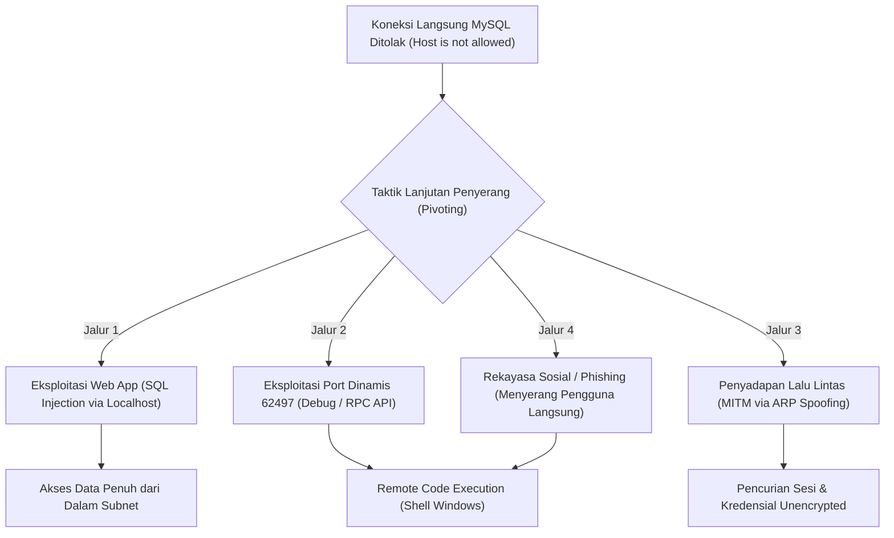

### 5.1. Jalur 1: Menyerang Lewat Aplikasi Web Lokal (Bypass via SQL Injection)
* **Logika Penyerang:** MySQL menolak IP penyerang (`192.168.1.25`), tetapi MySQL **selalu mengizinkan koneksi dari `localhost` (`127.0.0.1`)**.
* **Cara Kerja:** Penyerang mencari aplikasi web lokal (misal: Apache/Nginx, server Node.js, atau web service internal) yang terhubung ke database tersebut. Jika aplikasi web memiliki celah **SQL Injection (SQLi)**, penyerang menyuntikkan kueri SQL lewat input web.
* **Dampak:** Kueri dijalankan oleh web server yang berada di `localhost`. Proteksi `Host is not allowed` **dilewati secara total**, memungkinkan penyerang mengekstrak seluruh data basis data.

### 5.2. Jalur 2: Penetrasi Port Tersembunyi `62497/tcp` (High Port Debug/RPC)
* **Logika Penyerang:** Port dinamis tinggi sering dibuka oleh utilitas pengembangan (seperti debugger Node.js, Python microservices, atau agent manajemen remote) yang kerap lupa diberi proteksi autentikasi.
* **Cara Kerja:** Penyerang mengirimkan payload interogasi:
  ```bash
  nc -v 192.168.1.10 62497
  curl -v http://192.168.1.10:62497
  ```
* **Dampak:** Jika port ini merupakan service rentan, penyerang dapat mengeksekusi kode perintah sistem (*Remote Command Execution*) untuk mendapatkan akses shell ke Windows target, lalu membuka MySQL secara lokal tanpa halangan.

### 5.3. Jalur 3: Penyadapan Lalu Lintas (*MITM via ARP Spoofing*)
* **Logika Penyerang:** Hasil pemindaian `netdiscover` membuktikan router Fiberhome tidak mengisolasi lalu lintas antar-klien di Wi-Fi.
* **Cara Kerja:** Penyerang melancarkan serangan **ARP Poisoning**:
  ```bash
  arpspoof -i wlan0 -t 192.168.1.10 192.168.1.1
  ```
* **Dampak:** Seluruh lalu lintas internet dari laptop target berbelok melewati laptop penyerang. Penyerang dapat menyadap kredensial login unencrypted, kueri DNS, dan memanipulasi sesi browsing (*session hijacking*).

### 5.4. Jalur 4: Rekayasa Sosial (*Social Engineering & Client-Side Phishing*)
* **Logika Penyerang:** Ketika pertahanan sistem (firewall dan permission) sulit ditembus dari luar, penyerang akan menargetkan titik terlemah dalam keamanan informasi: **faktor manusia**.
* **Cara Kerja:** Mengirimkan file dokumen atau installer palsu (misalnya notifikasi *browser update* palsu saat browsing). Begitu korban mengeksekusi file, malware langsung menghubungi penyerang dari dalam (*outbound reverse shell*), melewati batasan firewall dan izin host MySQL.

### 5.5. Pelajaran Fundamental: Konsep "Defense-in-Depth" (Pertahanan Berlapis)
Pengujian empiris ini mendemonstrasikan prinsip dasar arsitektur keamanan siber:
1. **Lapis 1 (Firewall Windows):** Berhasil melindungi protokol SMB (Port 445 aman).
2. **Lapis 2 (MySQL Host Permission):** Berhasil menggagalkan serangan brute-force Hydra langsung.
3. **Lapis 3 (Port Exposure):** Lemah, karena port 3306 tetap terlihat dari jaringan luar, memancing penyerang untuk mencari celah sekunder.

---

## 6. MATRIKS RISIKO & PENILAIAN KERENTANAN (VULNERABILITY MATRIX)

Berdasarkan standar **Common Vulnerability Scoring System (CVSS v3.1)**, temuan audit dievaluasi sebagai berikut:

| ID Kerentanan | Deskripsi Temuan | Port Terdampak | CVSS v3.1 Base Score | Tingkat Risiko |
| :--- | :--- | :--- | :--- | :--- |
| **VULN-NET-01** | **Exposed Database Management Service to LAN Subnet** (Port MySQL 3306 & 33060 terbuka ke seluruh host jaringan) | `3306/tcp`, `33060/tcp` | **6.5 (Medium)**  <br>`CVSS:3.1/AV:A/AC:L/PR:N/UI:N/S:U/C:L/I:L/A:N` | 🟠 **MEDIUM** |
| **VULN-NET-02** | **Potential Blindspot in Fast Port Scanning** (Port layanan non-standar tidak teridentifikasi pada konfigurasi scan default) | `33060/tcp`, `62497/tcp` | **4.3 (Medium)**  <br>`CVSS:3.1/AV:A/AC:L/PR:N/UI:N/S:U/C:L/I:N/A:N` | 🟡 **LOW - MEDIUM** |
| **VULN-NET-03** | **Unrestricted Layer 2 ARP Topology Reconnaissance** (Subnet mengizinkan penemuan seluruh host tanpa isolasi port) | Subnet `192.168.1.0/24` | **3.5 (Low)**  <br>`CVSS:3.1/AV:A/AC:L/PR:N/UI:N/S:U/C:L/I:N/A:N` | 🟢 **LOW** |

---

## 7. REKOMENDASI PERBAIKAN & REMEDIASI (BLUE TEAM DEFENSE)

Untuk menutup celah keamanan yang terungkap dari kegiatan audit ini, direkomendasikan langkah-langkah mitigasi berikut:

### 1. Solusi Cepat 1 Menit: Batasi Binding Address MySQL ke Localhost (Solusi Utama)
Server MySQL pada target `192.168.1.10` tidak boleh mendengarkan paket pada alamat `0.0.0.0` jika hanya digunakan untuk aplikasi lokal (seperti XAMPP, Laragon, atau Docker lokal).
* **Langkah Konfigurasi (`my.ini` atau `my.cnf`):**
  ```ini
  [mysqld]
  # Batasi hanya mendengarkan loopback lokal
  bind-address = 127.0.0.1
  mysqlx_bind_address = 127.0.0.1
  ```
* **Verifikasi:** Setelah restart layanan MySQL, port 3306 tidak akan lagi terlihat terbuka saat dipindai oleh host lain di jaringan (status berubah menjadi `closed` atau `filtered`).

### 2. Pengetatan Aturan Windows Defender Firewall
Jika port 3306 memang perlu diakses oleh host lain (misalnya arsitektur client-server tertentu), jangan biarkan terbuka ke seluruh subnet:
* Buat aturan *Inbound Rule* khusus di Windows Firewall yang membatasi IP sumber (*Scope Remote IP Address*) hanya ke IP klien tertentu yang diizinkan, dan tolak IP lain.

### 3. Penerapan AP Isolation pada Access Point (Router Fiberhome)
Pada antarmuka administrasi router Fiberhome (`192.168.1.1`):
* Aktifkan fitur **AP Isolation** atau **Client Isolation** pada menu pengaturan Wi-Fi.
* **Manfaat:** Mengisolasi komunikasi Layer 2 antar sesama klien nirkabel sehingga serangan *ARP Sweep*, *ARP Spoofing*, dan *Lateral Movement* antar sesama perangkat yang terhubung ke Wi-Fi yang sama dapat dicegah secara total.

### 4. Implementasi Deteksi Port Scan pada NIDS (Suricata / Snort)
Untuk mendeteksi pemindaian agresif seperti Nmap T4 di masa mendatang, terapkan signature NIDS berikut:
```snort
alert tcp $HOME_NET any -> $HOME_NET 3306 (msg:"AUDIT: Potential MySQL Reconnaissance from LAN"; flags:S; threshold:type both, track by_src, count 5, seconds 10; sid:1000033; rev:1;)
```

---

## 8. KESIMPULAN

Audit penetrasi jaringan internal, enumerasi layanan, dan simulasi eksploitasi berhasil diselesaikan dengan baik sesuai metodologi standar industri. Seluruh **10 bukti pemindaian dan pengujian teknis** berhasil mendokumentasikan postur keamanan jaringan lokal:
* Target memiliki pertahanan firewall yang baik pada protokol SMB (Port 445 aman dari ancaman EternalBlue).
* Target berhasil menahan serangan langsung *brute-force* Hydra melalui kontrol izin host MySQL bawaan.
* Namun, keterbukaan port database ke jaringan umum tetap menjadi risiko kritis yang memancing penyerang beralih ke taktik lanjutan (*pivoting*, *SQL Injection*, atau *MITM*).
* Pembuktian komparasi teknis menunjukkan bahwa pemindaian *Full 65535 Ports* wajib dilakukan untuk mencegah celah keamanan tersembunyi.

Rekomendasi mitigasi praktis (seperti pengubahan *bind-address* ke `127.0.0.1`) telah diserahkan dan dapat segera dieksekusi untuk menutup permukaan serangan secara instan.

---
*Laporan ini disusun secara profesional untuk tujuan pengujian keamanan berizin, edukasi akademik, dan penguatan sistem pertahanan siber.*
